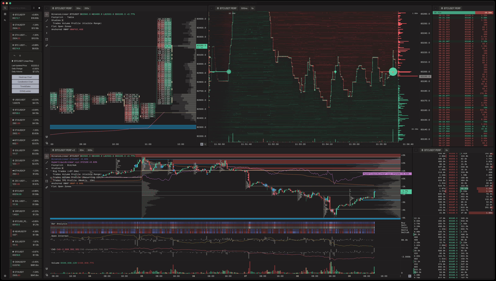

# Flowsurface

[](https://crates.io/crates/flowsurface)
[](https://github.com/flowsurface-rs/flowsurface/actions/workflows/lint.yml)
[](https://github.com/flowsurface-rs/flowsurface/actions/workflows/format.yml)
[](https://discord.gg/RN2XAF7ZuR)
[](https://github.com/flowsurface-rs/flowsurface/blob/main/LICENSE)
[](https://github.com/iced-rs/iced)

An open-source native desktop charting application for crypto markets. Supports Binance, Bybit, Hyperliquid, OKX, and MEXC.

<div align="center">
  
</div>

## Key Features

- Multiple chart/pane types:
    - **Time & Sales:** Scrollable list of live trades that can be merged across multiple tickers.
    - **DOM (Depth of Market) / Ladder:** Displays current orderbook alongside recent trade volumes on grouped price levels.
    - **Heatmap (Historical DOM):** Uses live trades and orderbook to display a time-series heatmap chart. Supports customizable price grouping and different timeframes.
    - **Candlestick:** Footprints, profiles, scriptable indicators, custom tick-based intervals. See [Indicators](#indicators) and [Studies](#studies).
- Real-time sound effects driven by trade streams
- Multi window/monitor support on macOS and Linux.[\*](#platform-notes)
- Persistent layouts, chart presets, themes with editable color palettes.

## Market Data

**Live:** Trades, orderbook, and kline updates stream from exchange WebSocket feeds.

**Historical trades:** Optional backfill for the visible range on time-based candlestick charts.
Can be enabled in **Settings → Network**. Three modes are available:

- **Off**: No historical backfill.
- **Exchange**: Fetches directly from Binance's public REST API and bulk data
  mirrors ([data.binance.vision](https://data.binance.vision/)). Daily archives use
  bulk files and are cached on disk for reuse; intraday ranges are paginated and
  rate-limited. **Binance only** (spot, linear, inverse).
- **Server**: Fetches from a server that exposes a
  `GET /trades.arrow` endpoint. The reference implementation, [`flowsurface-server`](https://github.com/flowsurface-rs/server), is a
  self-contained collector that writes trades to DuckDB and serves them over this protocol.
  See its [README](https://github.com/flowsurface-rs/server#get-tradesarrow) for the schema,
  query parameters, and auth. Works with every exchange the app supports, provided the server collects that venue.

**Historical klines, open interest, ticker metadata/stats:** Always fetched from exchange
REST APIs, regardless of the trade-fetch mode.

## Indicators

Candlestick charts include [bundled indicators](data/indicators/README.md), more can be added manually or using the
catalog browser.

**Catalog browser**: Open the chart pane's **Indicators** sidebar and click **+**. The browser fetches
a manifest of contributed indicators from `https://api.flowsurface.com`. The manifest is
built from the [catalog repository](https://github.com/flowsurface-rs/indicators/tree/main/sources) at a
pinned commit; installing downloads the selected `.ind` source from the catalog server, verifies it
against the manifest checksum, and compiles it locally before installation.

**Manual install**: Open **Settings → Open data folder** and copy `.ind` files into `indicators/`, then
restart the app. The data directory is `$FLOWSURFACE_DATA_PATH` when set, otherwise your platform's data
directory under `flowsurface/`. The installed-indicator directory can also be overridden with
`FLOWSURFACE_INDICATORS_PATH`.

To write your own indicators, see the [language reference and examples](indicator-engine/LANGUAGE.md) and the
[CLI workflow](indicator-engine/README.md#cli).

## Studies

Footprint requires **Trade data** to be enabled in the pane settings and enough zoom for their columns to be
visible. Backfill is optional and is configured in **Settings → Network**. Some details that may not be clear in the UI:

- A pane uses one profile source: **_candle-based_** or **_trade-based_**. Same-source studies can coexist (one visible-range profile, one recurring profile, one TPO); the `Big Trades` study is trade-only and independent.
- **_Candle-based_** studies are sourced using lower timeframe `Kline` data: `1m` up to `2h`, `3m` up to `4h`, `5m` up to `12h`, and `15m` above that. They are approximations: a candle only gives a high/low range, so volume is spread across that range and TPO marks it. Without a buy/sell split, the candle's volume is treated as buy when `close >= open`, else sell.
- **_Trade-based_** studies use actual prints, so they are more precise, but need trades data, optionally backfill and more processing. Trade versions exist for volume and TPO profiles.
- `TPO` anchors are UTC; initial balance is the first hour from the profile start (for weekly/monthly, the first hour of that week/month).
- The `Big Trades` study filters on quote-currency notional; rings group multiple trades.

## Installation

### Method 1: Prebuilt Binaries

Downloads are available on the [Releases page](https://github.com/flowsurface-rs/flowsurface/releases).

- **macOS**: Open the universal DMG and drag Flowsurface into Applications. Supports Apple Silicon and Intel Macs running macOS 11 or newer.
- **Windows**: Run the x64 MSIX to install for your current user, then launch Flowsurface from the Start menu. No administrator approval is required.
- **Linux**: Extract the archive and run `./install.sh` without sudo, then launch Flowsurface from the application menu. Run `./install.sh` from a newer archive to upgrade, or `./uninstall.sh` to remove the app. Settings and credentials are preserved. For portable use, run `./bin/flowsurface` directly.

<details><summary><strong>Having trouble running the file? (Permission/Security warnings)</strong></summary>
 
Windows executables and MSIX installers are code-signed; macOS apps have no Apple Developer ID signature or notarization. Security warnings may still appear.

- **Windows**: If App Installer cannot verify the publisher or signing certificate, [report the installation error](https://github.com/flowsurface-rs/flowsurface/issues).
- **macOS**: If you see "Developer cannot be verified", control-click (right-click) the app and select **Open**, or go to _System Settings > Privacy & Security_ to allow it.</details>

### Method 2: Build from Source

#### Requirements

- [Rust toolchain](https://www.rust-lang.org/tools/install)
- [Git version control system](https://git-scm.com/)
- System dependencies:
    - **Linux**:
        - Debian/Ubuntu: `sudo apt install build-essential pkg-config libasound2-dev`
        - Arch: `sudo pacman -S base-devel alsa-lib`
        - Fedora: `sudo dnf install gcc make alsa-lib-devel`
    - **macOS**: Install Xcode Command Line Tools: `xcode-select --install`
    - **Windows**: No additional dependencies required

#### Option A: `cargo install`

```bash
# Install latest globally
cargo install --git https://github.com/flowsurface-rs/flowsurface flowsurface

# Run
flowsurface
```

#### Option B: Cloning the repo

```bash
# Clone the repository
git clone https://github.com/flowsurface-rs/flowsurface

cd flowsurface

# Build and run
cargo build --release
cargo run --release
```

### Platform Notes

<details open>
<summary><strong>Windows</strong></summary>

> ⚠️ Multi-window support is disabled on Windows due to a [redraw issue](https://github.com/rust-windowing/winit/issues/3648) affecting iced’s current winit backend.

</details>

## Community

Discord: https://discord.gg/RN2XAF7ZuR

## Acknowledgments

- Free code signing for Windows releases is provided by [SignPath.io](https://about.signpath.io/), certificate by [SignPath Foundation](https://signpath.org/)
- [Kraken Desktop](https://www.kraken.com/desktop) (formerly [Cryptowatch](https://blog.kraken.com/product/cryptowatch-to-sunset-kraken-pro-to-integrate-cryptowatch-features)), the main inspiration that sparked this project
- [Halloy](https://github.com/squidowl/halloy), an excellent open-source IRC client, the main reference for the foundational code design
- And of course, [iced](https://github.com/iced-rs/iced), the GUI library that makes this possible

## Privacy

Flowsurface has no telemetry or analytics. See [PRIVACY.md](PRIVACY.md) for the services it
contacts and what stays local.

## License

Flowsurface is released under [GPL-3.0-or-later](LICENSE).
Some components use separate licenses:

| Component                                                                               | License                                                                      |
| --------------------------------------------------------------------------------------- | ---------------------------------------------------------------------------- |
| Application, data crate, and [bundled indicators](data/indicators/README.md)            | [GPL-3.0-or-later](LICENSE)                                                  |
| Indicator engine and CLI                                                                | [Apache-2.0](indicator-engine/LICENSE)                                       |
| [Indicator catalog](https://github.com/flowsurface-rs/indicators) and its documentation | [Apache-2.0](https://github.com/flowsurface-rs/indicators/blob/main/LICENSE) |
| Exchange adapters (`flowsurface-exchange`)                                              | [MIT](exchange/LICENSE)                                                      |

Contributions follow the license of the component being changed; submit catalog indicators to the [indicators repository](https://github.com/flowsurface-rs/indicators/blob/main/CONTRIBUTING.md).
